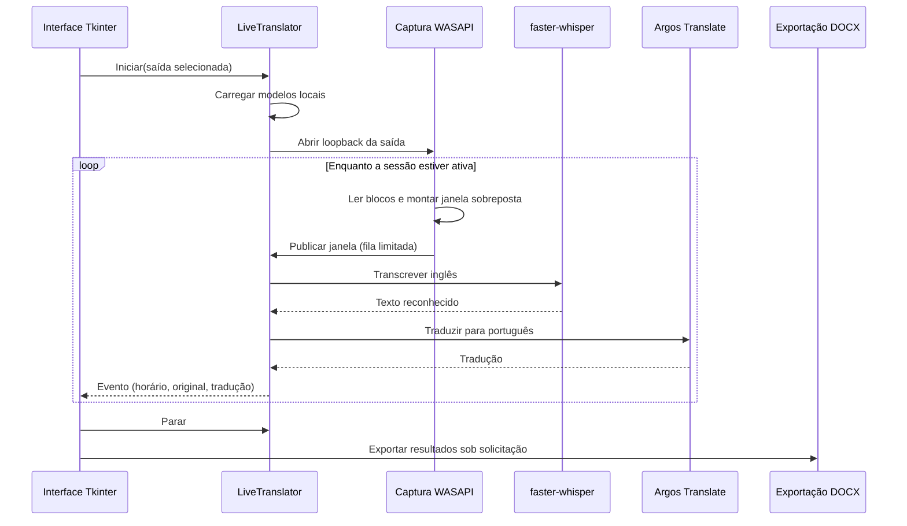

# Arquitetura

## Objetivo e escopo

VoxNexo é um desktop audio translator para Windows. Captura fala em inglês presente na saída de áudio do computador usando WASAPI loopback por meio de SoundCard; nenhum microfone é aberto. A inferência de reconhecimento e tradução é local.

## Componentes

| Componente | Responsabilidade |
| --- | --- |
| `src/tradutor_ao_vivo/app.py` | Janela Tkinter, seleção de saída, ciclo da sessão e apresentação dos eventos. |
| `src/tradutor_ao_vivo/live_translator.py` | Carregamento de modelos, captura loopback, reamostragem, transcrição, remoção de sobreposição e tradução. |
| `src/tradutor_ao_vivo/word_export.py` | Criação de documento `.docx` a partir dos resultados da sessão. |
| `scripts/` | Tarefas operacionais para instalar modelos e listar saídas de áudio. |
| `packaging/windows/` | Spec do PyInstaller e definição do instalador Inno Setup. |
| `tests/` | Testes de lógica pura e serialização do documento Word. |

## Fluxo e concorrência

A captura e a inferência executam em threads separadas. A fila de áudio possui capacidade limitada de uma janela; se o processamento atrasar, a janela antiga é descartada para manter a latência sob controle. Eventos são encaminhados à interface por uma fila e consumidos na thread principal do Tkinter.

## Dados e privacidade

- O processo lê o áudio reproduzido na saída selecionada; não salva gravação de áudio.
- Original e tradução ficam em memória durante a sessão.
- O `.docx` só é criado por ação explícita do usuário.
- `faster-whisper` e Argos baixam modelos para o cache local na primeira execução. Depois, a inferência não envia áudio/texto para serviços externos.

## Empacotamento

`packaging/windows/tradutor_ao_vivo.spec` é a fonte de configuração do PyInstaller, incluindo a fonte Manrope e sua licença. `scripts/build_windows.bat` roda os gates de qualidade, gera `dist/VoxNexo.exe` e chama Inno Setup para produzir `dist/installer/Setup_VoxNexo.exe`.

## Decisões e limitações

- O projeto usa `src/` layout para separar o pacote instalável dos testes e scripts.
- `pyproject.toml` é a fonte única de metadados, dependências e configuração de ferramentas.
- A transcrição está fixada para inglês e usa `distil-small.en`.
- A tradução é inglês → português com Argos Translate local; a variante pode ser português europeu.
- A seleção de saída é explícita na interface para evitar inferir uma fonte errada.
- A apresentação usa a paleta VoxNexo (navy, blue, cyan e light) e Manrope variável empacotada no aplicativo.
