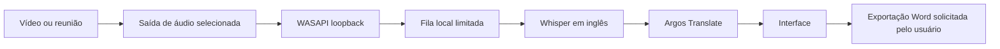

# VoxNexo

VoxNexo é um desktop audio translator para Windows: captura o áudio reproduzido pelo computador, transcreve fala em inglês e exibe a tradução local para português. Não abre nem usa o microfone.

## Funcionalidades

- Captura WASAPI loopback da saída de áudio selecionada.
- Identidade visual em navy, blue, cyan e superfícies claras, com tipografia Manrope.
- Transcrição em inglês com `faster-whisper` e o modelo `distil-small.en`.
- Tradução inglês-português local com Argos Translate.
- Interface para iniciar/parar, acompanhar resultados e selecionar a saída do computador.
- Exportação sob demanda para Word `.docx`.
- Processamento em threads separadas, com fila limitada para priorizar áudio recente.

## Arquitetura

Veja [ARCHITECTURE.md](ARCHITECTURE.md) para os componentes, fluxo de dados, concorrência, privacidade e decisões técnicas. As instruções de contribuição e quality gates estão em [CONTRIBUTING.md](CONTRIBUTING.md).



## Requisitos

- Windows 10 ou 11 e uma saída de áudio ativa.
- Python 3.13 para executar a partir do código.
- Inno Setup 6 para gerar o instalador Windows.
- Acesso à internet na primeira configuração/execução para baixar dependências e modelos. A inferência subsequente ocorre localmente.

## Instalação para uso

Execute `dist\installer\Setup_VoxNexo.exe` e siga o assistente. A instalação é por usuário, não exige privilégios de administrador e cria um atalho no menu Iniciar. O atalho na área de trabalho é opcional.

Também é possível abrir `dist\VoxNexo.exe` sem instalar. Os modelos de IA são baixados separadamente na primeira execução, não estão embutidos nos executáveis.

## Desenvolvimento

No PowerShell, na raiz do projeto:

```powershell
py -3.13 -m venv .venv
Set-ExecutionPolicy -Scope Process -ExecutionPolicy RemoteSigned
.\.venv\Scripts\Activate.ps1
python -m pip install --upgrade pip
python -m pip install -e ".[dev,build]"
python -m tradutor_ao_vivo
```

No CMD, ative o ambiente com `.venv\Scripts\activate.bat`.

Para baixar o modelo Argos antecipadamente:

```powershell
python scripts\install_translation_model.py
```

A interface usa a fonte variável Manrope do Google Fonts, distribuída em `src/tradutor_ao_vivo/assets/fonts/` sob a licença SIL Open Font License 1.1. O TTF e a licença acompanham o pacote; a fonte é carregada localmente e não exige acesso à internet durante o uso.

Para listar as saídas de áudio visíveis ao Windows:

```powershell
python scripts\list_audio_outputs.py
```

## Testes e lint

```powershell
python -m pytest
python -m ruff check src tests scripts
```

O workflow [.github/workflows/ci.yml](.github/workflows/ci.yml) executa esses quality gates em Windows com Python 3.13 para cada push e pull request.

## Build e empacotamento

Instale o [Inno Setup 6](https://jrsoftware.org/isinfo.php) e execute:

```powershell
scripts\build_windows.bat
```

O build instala o projeto e os extras `dev/build`, roda testes, lint e formatação, gera `dist\VoxNexo.exe` com a configuração em `packaging\windows\tradutor_ao_vivo.spec` e produz `dist\installer\Setup_VoxNexo.exe` com `packaging\windows\installer.iss`.

O instalador é um `Setup.exe` com assistente e desinstalador; não é MSI. Os artefatos em `build/` e `dist/` não devem ser adicionados ao controle de versão.

## Uso

1. Abra o vídeo ou entre na reunião no computador.
2. Inicie o VoxNexo e selecione a saída usada pelo vídeo/reunião.
3. Clique em **Iniciar tradução** e acompanhe o original e a tradução.
4. Clique em **Parar** ao terminar.
5. Selecione **Exportar Word** e escolha o destino do `.docx`.

O aplicativo não recupera o áudio reproduzido antes do início da captura. O tempo de resposta inclui a janela de áudio e o tempo de inferência local; em computadores sob alta carga pode haver atraso.

## Dados, privacidade e limitações

- O áudio é capturado da saída do computador, processado em memória e não gravado como arquivo.
- Texto original e tradução ficam em memória durante a sessão. O `.docx` é criado somente por solicitação do usuário.
- Os modelos são baixados uma vez para o cache local. Não há chamadas remotas por trecho nem cobrança por inferência.
- O idioma de entrada está definido como inglês. O modelo não é adequado para reconhecer outros idiomas.
- Argos pode produzir variantes de português europeu e tem menos contexto que tradutores hospedados; trechos curtos e interjeições podem ficar menos naturais.
- O fluxo atual não precisa de chave de API.

## Estrutura

```text
whisper_project/
├── src/tradutor_ao_vivo/       # Pacote Python da aplicação
├── tests/                      # Testes unitários
├── scripts/                    # Instalação de modelos, utilitário de áudio e build
├── packaging/windows/          # Configuração PyInstaller e Inno Setup
├── .github/workflows/ci.yml    # CI Windows
├── pyproject.toml               # Dependências, metadados e ferramentas
├── README.md
├── ARCHITECTURE.md
└── CONTRIBUTING.md
```

`pyproject.toml` é a fonte única de metadados, dependências e configuração de pytest/Ruff. O pacote Python usa o namespace interno `tradutor_ao_vivo` e oferece o comando `voxnexo` após instalação editável.
